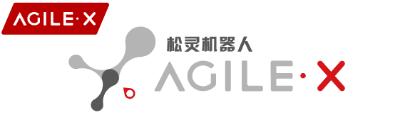

Founded in 2016, AgileX Robotics is committed to advancing embodied intelligence innovation and accelerating the global commercialization of robotics through our full-stack robotic technologies and open-source ecosystem.

Rooted in self-developed multi-modal mobile chassis technology, AgileX continuously pushes the boundaries of robots—including robotic arms, data collection devices, and cobots—delivering cutting-edge solutions for academic research and industrial innovation.

To accelerate industry progress, AgileX has launched a data-sharing program that provids global developers with foundational support for AI training and algorithm development. We actively contribute to open-source communities like ROS and Hugging Face, teaming up with experts to turn lab breakthoughts into real-world robotics solutions.

| **Title**                    | **Description**                                              |
| ---------------------------- | ------------------------------------------------------------ |
| AgileX-Robotics-user-manuals | [EN Manual](https://global.agilex.ai/pages/manual)  [中文手册](https://agilexsupport.yuque.com/staff-hso6mo/dna5gm/gi7odbvgetmuvtzw?singleDoc) |
| Open Source Technology Posts | [Agilex-College](https://github.com/agilexrobotics/Agilex-College)，AgileX Robot product open‑source examples and tutorials (PIPER\|NERO\|LIMO function demos) |
| UGV_GAZEBO_SIM               | [UGV_GAZEBO_SIM](https://github.com/agilexrobotics/ugv_gazebo_sim)， includes chassis: Scout Series; Ranger Series; Hunter Series; Bunker Series; Tracer Series; Limo Series |
| UGV_SDK                      | The [UGV_SDK](https://github.com/agilexrobotics/ugv_sdk) for chassis development is available in C++ and can be used in Linux、Windows. |
| Scout Series                 | [Scout_ros ](https://github.com/agilexrobotics/scout_ros)： ROS1 package [Scout_ros2](https://github.com/agilexrobotics/scout_ros2) ：ROS2 package Compatible with Scout2.0, Scout Mini, Scout Mini (omni) |
| Ranger Series                | [Ranger_ros](https://github.com/agilexrobotics/ranger_ros)：ROS1 package  [Ranger_ros2](https://github.com/agilexrobotics/ranger_ros2)：ROS2 package Compatible with Ranger, Ranger Mini V2, Ranger Mini V3, Ranger air/Ranger delta |
| Hunter Series                | [Hunter_ros](https://github.com/agilexrobotics/hunter_ros)：ROS1 package  [Hunter_ros2](https://github.com/agilexrobotics/hunter_ros2)：ROS2 package Compatible with Hunter2.0, Hunter SE |
| Bunker Series                | [Bunker_ros](https://github.com/agilexrobotics/bunker_ros)：ROS1 package  [Bunker_ros2](https://github.com/agilexrobotics/bunker_ros2)：ROS2 package Compatible with Bunker Pro, Bunker, Bunker Mini |
| Tracer Series                | [Tracer_ros](https://github.com/agilexrobotics/tracer_ros)：ROS1 package  [Tracer_ros2](https://github.com/agilexrobotics/tracer_ros2)：ROS2 package Compatible with Tracer, Tracer2.0, Tracer Mini |
| Limo Series                  | [Limo_ros](https://github.com/agilexrobotics/limo_ros)：ROS1 package  [Limo_ros2](https://github.com/agilexrobotics/limo_ros2)：ROS2 package  Compatible with Limo, Limo Pro, Limo ROS2 |
| ARM Series                   | [PyAgxArm](https://github.com/agilexrobotics/pyAgxArm)：Arm Python SDK, compatible with Piper, Piper X, Piper L, Piper H, Nero [Agx_arm_ros](https://github.com/agilexrobotics/agx_arm_ros)：Arm ROS2 driver, compatible with Piper, Piper X, Piper L, Piper H, Nero  [Piper_ros](https://github.com/agilexrobotics/piper_ros)：Arm ROS1 driver, compatible with Piper, Piper X, Piper L, Piper H  [Agx_arm_urdf](https://github.com/agilexrobotics/agx_arm_urdf)：Arm URDF / Xacro models and corresponding 3D mesh resources [Agx_arm_sim](https://github.com/agilexrobotics/agx_arm_sim)：Arm ROS2 simulation and development toolkit, including Moveit package and USD files |
| Pika Series                  | [Pika_sdk](https://github.com/agilexrobotics/pika_sdk)：Pika series Python software toolkit; supports models Pika Sense and Pika Gripper [Pika_ros](https://github.com/agilexrobotics/pika_ros/tree/master)：Pika series ROS driver, includes ROS1 and ROS2 versions [PikaAnyArm](https://github.com/agilexrobotics/PikaAnyArm)：Implements teleoperation of Piper and Xarm lite6/UR robotic arms via Pika sense |
| Cobot_Magic                  | [Mobile_aloha_sim](https://github.com/agilexrobotics/mobile_aloha_sim)：Aloha series URDF/Xacro model files, including Cobot magic and split-type Aloha |
| Cobot Series                 | [Scout_cobot_sim](https://github.com/agilexrobotics/scout_cobot_sim)：ROS1 compatible simulation; corresponding kit model is Cobot Kit  [Cobot_s_sim](https://github.com/agilexrobotics/cobot_s_sim) ：ROS1 compatible simulation; corresponding kit model is Cobot S |
| NAVIS                        | [Navis](https://github.com/agilexrobotics/Navis) navigation API interface usage instructions, including Python/C++ demo programs; compatible product models UMR, Navis |
| LIFTING                      | [Lifting_ws](https://github.com/agilexrobotics/lifting_ws)：Lifting column ROS1 driver [Lifting_ws_ros2](https://github.com/agilexrobotics/lifting_ws_ros2)：Lifting column ROS2 driver |
| Camera driver                | Compatible camera models and drivers Realsense_ros：[ROS1](https://github.com/realsenseai/realsense-ros/tree/ros1-legacy)、[ROS2](https://github.com/realsenseai/realsense-ros) Dabai：[ROS1](https://github.com/orbbec/OrbbecSDK_ROS1/tree/main)、[ROS2](https://github.com/orbbec/OrbbecSDK_ROS2/tree/main) |

